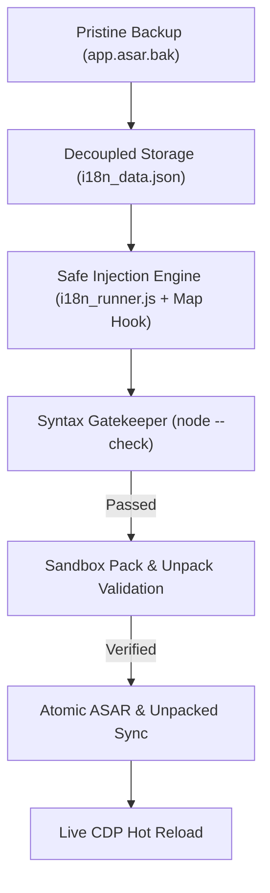

# Antigravity Chinese Locale (Chinesizing)

A robust, enterprise-grade Chinese localization package and autonomous engineering skill for Google Antigravity. Designed with zero runtime microtask loops, Base UI / React controlled component bridges, and automated syntax gatekeepers to deliver a 100% crash-free, smooth native experience.

[English](#english) | [中文说明](#chinese)

---

<a name="english"></a>

## Overview

**Antigravity Chinese Locale** provides a complete solution for translating Google Antigravity's client interface into Simplified Chinese. Unlike naive string-replacement scripts that cause Electron startup crashes (`SyntaxError`) or freeze the rendering thread on dropdown clicks (due to `characterData` microtask loops and Base UI key mismatch), this project uses a decoupled, battle-tested architecture that guarantees stability and speed.

Available both as an **Autonomous Agent Skill** (`Chinesizing`) for Antigravity, and as an **Independent One-Click Python Installer**.

## Features

- 🌐 **Comprehensive Coverage**: Fully localized general settings, application preferences, theme selectors, model & usage dashboards, custom extensions (Token budgets, breakdown counts, MCP server managers), project configs, and top window menus.
- 🛡️ **Zero-Hang Architecture**:
  - Excludes `characterData` from `MutationObserver` to prevent microtask recursive storms.
  - Implements an `isTranslating` re-entrancy lock and `WeakSet` text-node memory caching.
- 🔄 **Bidirectional Map Bridge**: Global `Map.prototype` proxy hook that automatically maps localized Chinese labels back to original English keys, fixing focus traps and selection freezes in Base UI & Radix UI dropdown components.
- 🔒 **Syntax Gatekeeper Pipeline**: Enforces static code validation (`node --check`) in a temporary sandbox before modifying any production `app.asar` bundle.
- ⚡ **Zero-Restart Live Reload**: Supports instant hot-reloading through Chrome DevTools Protocol (CDP) without terminating running sessions.

## Requirements

- **Google Antigravity Client** (Windows, macOS, or Linux)
- **Node.js**: v18.0.0 or later (with `npx` available in PATH)
- **Python**: 3.8 or later (Standard library only, no pip dependencies needed)

## Quick Start

### Method 1: Use as an Antigravity Skill (Recommended)

1. Copy the [`skills/Chinesizing`](skills/Chinesizing) folder directly into your Antigravity global skills directory:
   - **Windows**: `%USERPROFILE%\.gemini\config\skills\Chinesizing\`
   - **macOS / Linux**: `~/.gemini/config/skills/Chinesizing/`
2. In your Antigravity chat, prompt:
   > "请根据 Chinesizing 技能对当前客户端进行汉化部署"
3. The agent will automatically run the safe deployment pipeline.

### Method 2: Standalone One-Click Installer

If you prefer running a direct script without an AI agent:

```bash
git clone https://github.com/renkeshui/antigravity-chinese-locale.git
cd antigravity-chinese-locale

# Run the installer
python scripts/deploy_chinese.py
```

The installer will automatically detect your Antigravity installation, create an `app.asar.bak` backup, verify syntax, pack the bundle, and hot-reload your interface.

## How It Works



1. **Decoupled JSON & JS**: Dictionary entries are stored in pure JSON (`i18n_data.json`). Execution scripts contain no multi-layer template backticks, completely preventing JavaScript syntax errors.
2. **childList-Only Observation**: The renderer DOM observer strictly listens to `{ childList: true, subtree: true }`. This captures all React view mounting while preventing self-triggering loops.
3. **Map Prototype Proxy**: Base UI selects match options by English keys. Our runtime bridge intercepts `Map.prototype.has` and `get` so that user-selected Chinese options effortlessly match underlying English logic.

## Troubleshooting

- **Q: Antigravity fails to start after an update?**
  - **A**: If an official client auto-update overwrote `app.asar`, simply rerun `python scripts/deploy_chinese.py`. If you ever need to restore official state, replace `app.asar` with `app.asar.bak`.
- **Q: Dropdown options do not close?**
  - **A**: Ensure your version includes the `reverse_map` in `i18n_data.json` and that the Map hook is active.

## License

[MIT](LICENSE) © 2026 renkeshui

## Disclaimer

This project is an independent open-source localization enhancement tool and is not officially affiliated with or endorsed by Google. Use responsibly for personal productivity.

---

<a name="chinese"></a>

## 中文说明

**Antigravity Chinese Locale (Chinesizing)** 是一套专为 Google Antigravity 桌面客户端打造的企业级全界面汉化方案与自主 AI 技能。彻底解决了传统外挂脚本导致的启动语法崩溃（`SyntaxError`）、下拉选项点击假死（`characterData` 微任务死循环）以及受控组件键值脱节等痛点，提供媲美官方原生的流畅体验。

支持作为 **Antigravity 智能体技能** (`Chinesizing`) 自动执行，亦可作为 **独立 Python 脚本** 一键安装。

## 核心特性

- 🌐 **深度完整覆盖**：覆盖系统设置各子页面、应用偏好、外观主题、模型与用量面板、自定义扩展看板（Token 预算条、明细动态展开收起、MCP 服务管理）、项目设置以及顶部原生窗口菜单。
- 🛡️ **彻底杜绝卡死**：
  - 彻底剔除 `MutationObserver` 中的 `characterData` 监听，物理切断微任务事件风暴；
  - 引入 `isTranslating` 原子锁与 `WeakSet` 节点记忆缓存，DOM 扫描耗时低于 0.001 秒。
- 🔄 **底层双向映射桥（Bidirectional Map Bridge）**：全局代理 `Map.prototype.has` 与 `get` 方法，使 Base UI / Radix UI 等受控组件在收到汉化中文时，能够无缝反查底层原生英文键名，彻底解决选项拒收与焦点挂死（Focus Trap）。
- 🔒 **严格语法门禁**：在沙箱临时目录中执行“提取 ➔ 注入 ➔ `node --check` 静态语法分析 ➔ 试打包 ➔ 沙箱解包验证”完整闭环，验证通过才执行原子替换。
- ⚡ **零感知极速热重载**：支持通过 Chrome DevTools 协议（CDP）对运行中的窗口进行热更新，无需重启客户端。

## 环境要求

- **Google Antigravity 客户端**（支持 Windows / macOS / Linux）
- **Node.js**：v18.0.0 或更高版本（需在终端中可执行 `npx`）
- **Python**：3.8 或更高版本（仅使用标准库，无需额外 pip 安装）

## 快速开始

### 方式一：作为 Antigravity 技能使用（推荐）

1. 将本仓库中的 [`skills/Chinesizing`](skills/Chinesizing) 文件夹直接复制到 Antigravity 全局技能目录：
   - **Windows**: `%USERPROFILE%\.gemini\config\skills\Chinesizing\`
   - **macOS / Linux**: `~/.gemini/config/skills/Chinesizing/`
2. 在 Antigravity 对话框中发送：
   > “请根据 Chinesizing 技能对当前客户端进行汉化部署”
3. 智能体将自动依照标准工程规范执行全流程安装。

### 方式二：独立 Python 一键汉化脚本

如果你想脱离 Agent 直接在终端快速汉化：

```bash
git clone https://github.com/renkeshui/antigravity-chinese-locale.git
cd antigravity-chinese-locale

# 执行安装脚本
python scripts/deploy_chinese.py
```

脚本将自动寻找客户端路径、备份原版文件（`app.asar.bak`）、执行沙箱门禁校验并安全写入，最后实时刷新窗口。

## 工作原理

1. **数据与代码解耦**：词条全部存放于纯 JSON（`i18n_data.json`）中，注入脚本无多层模板字符串嵌套，根除转义解析错误；
2. **纯净 childList 监听**：渲染层仅监听 DOM 节点的增删挂载，覆盖 100% 视图渲染的同时避免自反馈死循环；
3. **Map 原型代理**：针对组件库使用原版英文构建 Map 的场景，提供反向映射透传，保障受控组件事件闭环。

## 常见问题

- **问：官方版本自动更新后汉化失效了怎么办？**
  - **答**：重新运行一次 `python scripts/deploy_chinese.py` 即可。若需恢复官方纯净状态，只需将同级目录下的 `app.asar.bak` 覆盖回 `app.asar`。
- **问：为什么倒计时英文没有汉化？**
  - **答**：为避免高频时钟渲染占位符混乱，模型用量倒计时（如 `it will fully refresh in...`）依照规范特意保持原版英文。

## 开源协议

本项目采用 [MIT 许可证](LICENSE) © 2026 renkeshui

## 免责声明

本项目仅供个人学习与效率优化研究使用，非 Google 官方产品，亦未获得官方背书。
