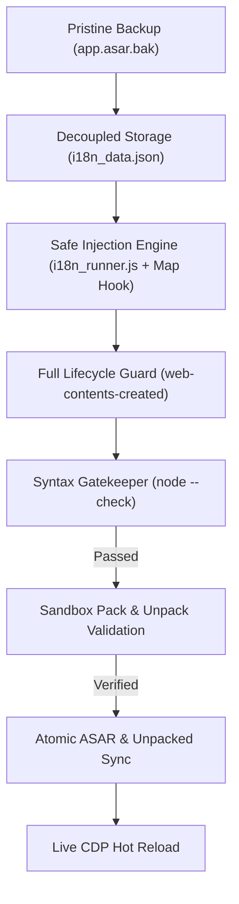

# Antigravity Chinese Locale (Chinesizing)

A robust, enterprise-grade Chinese localization package and autonomous engineering skill for Google Antigravity. Designed with full WebContents lifecycle guards, zero runtime microtask loops, Base UI / React controlled component bridges, and automated syntax gatekeepers to deliver a 100% persistent, crash-free, smooth native experience.

[English](#english) | [中文说明](#chinese)

---

<a name="english"></a>

## Overview

**Antigravity Chinese Locale** provides an enterprise-ready solution for translating Google Antigravity's desktop interface into Simplified Chinese. 

Unlike naive string-replacement scripts that cause Electron startup crashes (`SyntaxError`), dropdown freezes (from `characterData` microtask loops and Base UI key mismatch), or lose translations upon app restart/refresh (due to single-point `dom-ready` hooks and background tray process persistence), this project introduces an advanced **Full-Lifecycle Guard** and **Value-Matching Self-Healing Engine** that guarantees 100% persistence, speed, and rock-solid stability.

Available both as an **Autonomous Agent Skill** (`Chinesizing`) for Antigravity, and as an **Independent One-Click Python Installer**.

## Features (v2.0 Breakthroughs)

- 🌐 **Comprehensive Coverage (424+ Entries)**: Fully localizes General Settings, Application Preferences, Appearance & Themes, Models & Quotas, MCP Server Management, Project Configuration, Session History, and Native Window Menus.
- 🔄 **Persistent Lifecycle Guards (Solves Restart/Reload Bug)**:
  - Hooks directly into Electron's global `app.on('web-contents-created')` to monitor `dom-ready`, `did-finish-load`, and `did-navigate-in-page`.
  - Injects wake-up compensation into `showOrCreateWindow` to seamlessly re-apply localization when restoring from the background tray.
- ⚡ **Value-Matching Self-Healing (No Harmful WeakSet)**:
  - Abandons permanent `WeakSet` node blacklisting. Uses pure value comparison so dynamically rendered React nodes and SPA route changes are instantly and progressively localized without recursion.
- 🧩 **Fragmented TextNode Alignment**:
  - Handles nested tags (`<a>`, `<span>`) by gracefully decomposing and pairing sliced text nodes, eliminating mixed Chinese/English sentences.
- 🛡️ **Zero-Hang Architecture**:
  - Excludes `characterData` from `MutationObserver` to prevent microtask recursive storms.
  - Implements an atomic `isTranslating` re-entrancy lock.
- 🔄 **Bidirectional Map Bridge**:
  - Global `Map.prototype` proxy hook that automatically maps localized Chinese labels back to original English keys, fixing focus traps and selection freezes in Base UI & Radix UI dropdowns.
- 🔒 **Syntax Gatekeeper Pipeline**:
  - Enforces static code validation (`node --check`) in a temporary sandbox on `main.js`, `utils.js`, and `i18n_runner.js` before modifying any production `app.asar` bundle.
- ⚡ **Zero-Restart Live Reload**:
  - Supports instant hot-reloading through Chrome DevTools Protocol (CDP) without terminating running sessions.

## Requirements

- **Google Antigravity Client** (Windows, macOS, or Linux)
- **Node.js**: v18.0.0 or later (with `npx` available in PATH)
- **Python**: 3.8 or later (Standard library only, no pip dependencies needed)

## Quick Start

### Method 1: Use as an Antigravity Skill (Recommended)

1. Copy the [`skills/Chinesizing`](skills/Chinesizing) folder directly into your Antigravity global skills directory:
   - **Windows**: `%USERPROFILE%\.gemini\config\skills\Chinesizing\`
   - **macOS / Linux**: `~/.gemini/config/skills/Chinesizing/`
2. In your Antigravity chat, prompt:
   > "请根据 Chinesizing 技能对当前客户端进行汉化部署"
3. The agent will automatically run the safe deployment pipeline.

### Method 2: Standalone One-Click Installer

If you prefer running a direct script without an AI agent:

```bash
git clone https://github.com/renkeshui/antigravity-chinese-locale.git
cd antigravity-chinese-locale

# Run the installer
python scripts/deploy_chinese.py
```

The installer will automatically detect your Antigravity installation, create an `app.asar.bak` backup, verify syntax, pack the bundle, and hot-reload your interface.

> **Note on App Restart**: Antigravity runs in the background / system tray by default. If closing the window still displays English on reopen, right-click the Antigravity icon in your system tray and select **Quit** (or terminate the process in Task Manager) to allow the updated `app.asar` to load freshly from disk.

## How It Works



## License

[MIT](LICENSE) © 2026 renkeshui

## Disclaimer

This project is an independent open-source localization enhancement tool and is not officially affiliated with or endorsed by Google. Use responsibly for personal productivity.

---

<a name="chinese"></a>

## 中文说明

**Antigravity Chinese Locale (Chinesizing)** 是一套专为 Google Antigravity 桌面客户端打造的企业级全界面深度汉化方案与自主 AI 技能。彻底解决了传统外挂脚本导致的启动语法崩溃（`SyntaxError`）、下拉选项点击假死（`characterData` 微任务死循环）、受控组件键值脱节以及**退出重开变回英文**等顽疾，提供媲美官方原生的持久流畅体验。

支持作为 **Antigravity 智能体技能** (`Chinesizing`) 自动执行，亦可作为 **独立 Python 脚本** 一键安装。

## 核心特性 (v2.0 重大突破)

- 🌐 **全界面深度覆盖（424+ 精准词条）**：覆盖系统设置所有子页面、应用偏好、外观主题、模型与用量面板、MCP 服务管理、项目设置、会话历史列表以及顶部原生窗口菜单。
- 🔄 **全生命周期守卫（彻底攻克“重启/刷新失效”难题）**：
  - 在主进程注册 `app.on('web-contents-created')` 全局生命周期拦截网，全面监听 `dom-ready`、`did-finish-load` 与 `did-navigate-in-page`；
  - 在 `showOrCreateWindow` 唤醒链路中加入补救执行，保证从系统托盘唤醒时即刻保持汉化。
- ⚡ **纯值比对自愈引擎（弃用有害 WeakSet）**：
  - 弃用节点引用级的 `WeakSet` 永久黑名单，改用“纯值比对自愈”机制；SPA 路由跳转和异步组件重新渲染时自动毫秒级响应并汉化，绝不发生中途变回英文。
- 🧩 **内联切片文本（TextNode Fragmentation）精准缝合**：
  - 针对句子中间嵌套超链接（`<a>`）或 Badge 的复杂 DOM，细粒度切片匹配，杜绝半中半英。
- 🛡️ **彻底杜绝卡死与无限递归**：
  - 彻底剔除 `MutationObserver` 中的 `characterData` 监听，物理切断微任务事件风暴；
  - 引入 `isTranslating` 防重入原子锁，DOM 扫描耗时低于 0.001 秒。
- 🔄 **底层双向映射桥（Bidirectional Map Bridge）**：
  - 全局代理 `Map.prototype.has` 与 `get` 方法，使 Base UI / Radix UI 等受控组件在收到汉化中文时，能够无缝反查底层原生英文键名，彻底解决选项拒收与焦点挂死（Focus Trap）。
- 🔒 **严格语法门禁**：
  - 在沙箱临时目录中执行“提取 ➔ 注入 ➔ `node --check` 静态语法分析 ➔ 试打包 ➔ 沙箱解包验证”完整闭环，验证通过才执行原子替换。
- ⚡ **零感知极速热重载**：
  - 支持通过 Chrome DevTools 协议（CDP）对运行中的窗口进行热更新，无需立即重启客户端。

## 环境要求

- **Google Antigravity 客户端**（支持 Windows / macOS / Linux）
- **Node.js**：v18.0.0 或更高版本（需在终端中可执行 `npx`）
- **Python**：3.8 或更高版本（仅使用标准库，无需额外 pip 安装）

## 快速开始

### 方式一：作为 Antigravity 技能使用（推荐）

1. 将本仓库中的 [`skills/Chinesizing`](skills/Chinesizing) 文件夹直接复制到 Antigravity 全局技能目录：
   - **Windows**: `%USERPROFILE%\.gemini\config\skills\Chinesizing\`
   - **macOS / Linux**: `~/.gemini/config/skills/Chinesizing/`
2. 在 Antigravity 对话框中发送：
   > “请根据 Chinesizing 技能对当前客户端进行汉化部署”
3. 智能体将自动依照标准工程规范执行全流程安装。

### 方式二：独立 Python 一键汉化脚本

如果你想脱离 Agent 直接在终端快速汉化：

```bash
git clone https://github.com/renkeshui/antigravity-chinese-locale.git
cd antigravity-chinese-locale

# 执行安装脚本
python scripts/deploy_chinese.py
```

脚本将自动寻找客户端路径、备份原版文件（`app.asar.bak`）、建立全生命周期守卫、执行沙箱门禁校验并安全写入，最后实时刷新窗口。

> **关于彻底重启生效的提示**：Antigravity 默认在后台/系统托盘常驻运行。若关闭窗口后重新打开仍显示英文，只需在任务栏右下角托盘图标右键选择 **退出**（或在任务管理器结束残留进程）后重新打开，即可永久从磁盘加载生效。

## 常见问题

- **问：官方版本自动更新后汉化失效了怎么办？**
  - **答**：重新运行一次 `python scripts/deploy_chinese.py` 即可。若需恢复官方纯净状态，只需将同级目录下的 `app.asar.bak` 覆盖回 `app.asar`。
- **问：为什么倒计时英文没有汉化？**
  - **答**：为避免高频时钟渲染占位符混乱，模型用量倒计时（如 `it will fully refresh in...`）依照规范特意保持原版英文。

## 开源协议

本项目采用 [MIT 许可证](LICENSE) © 2026 renkeshui

## 免责声明

本项目仅供个人学习与效率优化研究使用，非 Google 官方产品，亦未获得官方背书。
