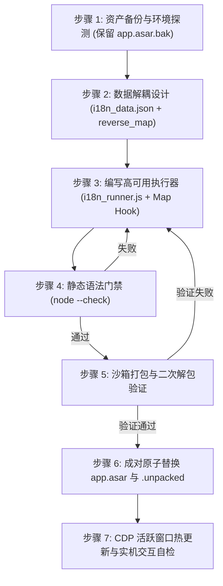

# Electron 桌面端软件深度汉化与防卡死工程规范

本技能整合了在 Electron 架构客户端（尤其是基于 React、Base UI、Monaco Editor 构建的现代复杂桌面应用）中进行**解包逆向、动态 DOM 汉化、架构解耦、防主进程崩溃、防渲染层死循环卡死与受控组件键值透传**的完整规章制度与生产级教训总结。

---

## 核心设计哲学 (Core Principles)

1. **数据与执行逻辑绝对解耦**：
   - 严禁将翻译字典以 JS 字符串字面量（特别是 ES6 反引号模板字符串 `` `...` ``）硬编码在执行逻辑中；
   - 翻译文本必须独立存储为标准的 `i18n_data.json`；
   - 渲染层脚本（`i18n_runner.js`）与主进程挂载脚本（`utils.js`）必须是独立的、零反引号嵌套冲突的静态文件。
2. **主进程零侵入与只读分发**：
   - 主进程核心模块（如 `dist/utils.js`）只负责在 `webContents.on('dom-ready')` 时异步读取并注入外部脚本，自身绝不包含任何界面业务逻辑；
   - 即使渲染层脚本出错，主进程也绝不抛错，保证客户端始终能够稳定拉起。
3. **严格门禁（Gatekeeper）先行**：
   - 任何修改在写入生产封包（`app.asar`）前，必须 100% 自动通过 `node --check` 语法分析；
   - 必须在沙箱临时目录中执行“打包 ➔ 解包 ➔ 再次校验”闭环，验证通过后才执行原子替换。
4. **受控组件状态生命线保护**：
   - 汉化不能只停留在“把英文改成中文”，必须深入组件库（Base UI、Radix UI 等）的受控机制，保障数据流与事件流的双向一致性。

---

## 惨痛教训与避坑红线 (Lessons Learned & Anti-Patterns)

### 🔴 教训一：反引号嵌套导致主进程 SyntaxError 启动崩溃
- **故障现象**：客户端启动弹窗报错 `SyntaxError: Unexpected identifier`，主进程树崩溃退出。
- **根本原因**：
  在拼接注入脚本时，外层使用了反引号模板字符串 `` `...` ``，而内层在处理动态文本（如 `` `查看 ${num} 项明细` ``）时同样使用了未转义的反引号。内层反引号导致外层字符串提前闭合，其后的中文关键字暴露为非法裸 Token，造成 JS 引擎语法解析致命错误。
- **规章死线**：
  1. **严禁在代码生成脚本中多层嵌套反引号**；
  2. 字符串拼接一律退回安全的 ES5 单引号/双引号加号拼接（`"查看 " + num + " 项明细"`）；
  3. 所有打包流水线必须强插 `node --check` 门禁，语法报错即刻终止打包。

---

### 🔴 教训二：`characterData: true` 监听引发渲染线程无限递归卡死
- **故障现象**：用户在系统设置中点击下拉选项或输入文字时，整个窗口完全卡死、无响应，CPU 占用率飙升至 100%。
- **根本原因**：
  `MutationObserver` 开启了 `characterData: true`。当用户切换选项时，React 更新了 DOM 文本节点；观察器捕获到 `characterData` 变更并调用 `translateNode` 修改 `node.nodeValue`；**修改 `node.nodeValue` 本身会立即向微任务队列中抛出新的 `characterData` mutation**，从而引发观察器自身在微任务阶段的无限递归死循环。
- **规章死线**：
  1. **绝对严禁在全文档范围开启 `characterData: true` 监听**！
  2. 观察器配置永远锁定为：`{ childList: true, subtree: true }`；
     - 现代 SPA（React、Vue 等）的页面渲染、子路由切换、弹窗展开、下拉列表挂载，均属于标准 DOM 节点树的增删（`childList`），完全足以覆盖 100% 的界面翻译需求；
  3. **必须配置防重入原子锁**：
     ```javascript
     var isTranslating = false;
     var obs = new MutationObserver(function (mutations) {
         if (isTranslating) return;
         isTranslating = true;
         try {
             for (var i = 0; i < mutations.length; i++) {
                 if (mutations[i].type === "childList") {
                     for (var j = 0; j < mutations[i].addedNodes.length; j++) {
                         translateNode(mutations[i].addedNodes[j]);
                     }
                 }
             }
         } finally {
             isTranslating = false;
         }
     });
     ```
  4. **必须使用 `WeakSet` 记忆已翻译节点**：
     ```javascript
     var translatedNodes = new WeakSet();
     function translateNode(node) {
         if (!node || translatedNodes.has(node)) return;
         if (node.nodeType === 3) {
             // 翻译完成后立即标记
             translatedNodes.add(node);
         }
     }
     ```

---

### 🔴 教训三：组件库“英文键值映射”受控状态失配（Key Mismatch）
- **故障现象**：点击特定下拉选项（如“安全预设模式”、“成果审查策略”）后，选项不会被选中，弹窗无法关闭，背景遮罩阻断所有鼠标点击，界面呈现假死。
- **根本原因**：
  前端组件（如 Base UI `Select` 或自定义组件 `Z0`）在内部使用原生英文构建了选项查找表：
  ```javascript
  // 内部注册的原版 Map
  var p = new Map([
      ["Always Ask", "always"],
      ["Always Proceed", "turbo"]
  ]);
  // 选项变更回调
  onValueChange: r => { p.has(r) && e(p.get(r)) }
  ```
  当 DOM 文本被翻译为 `"自动继续"` 后，Base UI 会将展示文本作为值回传给 `onValueChange(r)`。由于 `p.has("自动继续")` 为 `false`，核心回调 `e(...)` 被静默拒绝，导致 React 状态未能提交，受控浮层陷入无法关闭的死锁。
- **规章死线**：
  1. **构建双向映射字典（`reverse_map`）**：
     必须同时收集所有选项的中文到英文映射关系；
  2. **在主线程全局拦截 `Map.prototype.has` 与 `Map.prototype.get`（双向映射桥）**：
     ```javascript
     (function () {
         var REVERSE_MAP = data.reverse_map || {};
         if (!window.__antigravity_map_hooked) {
             window.__antigravity_map_hooked = true;
             var origHas = Map.prototype.has;
             var origGet = Map.prototype.get;

             Map.prototype.has = function (key) {
                 if (origHas.call(this, key)) return true;
                 if (typeof key === "string" && REVERSE_MAP[key]) {
                     return origHas.call(this, REVERSE_MAP[key]);
                 }
                 return false;
             };

             Map.prototype.get = function (key) {
                 var val = origGet.call(this, key);
                 if (val !== undefined) return val;
                 if (typeof key === "string" && REVERSE_MAP[key]) {
                     return origGet.call(this, REVERSE_MAP[key]);
                 }
                 return undefined;
             };
         }
     })();
     ```

---

### 🔴 教训四：`.unpacked` 目录与 `app.asar` 解耦失步
- **故障现象**：修改或重构 `app.asar` 后，软件启动时报模块加载失败或原生二进制缺失（如 `chrome-devtools-mcp`）。
- **根本原因**：
  Electron 会将包含 C/C++ 动态链接库（`.node` / `.exe`）的依赖解压存放于 `app.asar.unpacked` 目录中。若重打包时未加 `--unpack-dir` 声明，或替换生产包时未同步替换配套的 `.unpacked` 文件夹，会导致底层依赖寻址 404。
- **规章死线**：
  打包时必须指明解包白名单，部署时必须成对原子替换：
  ```bash
  npx @electron/asar pack "<src>" "<out.asar>" --unpack-dir "node_modules/chrome-devtools-mcp"
  # 部署时必须保持同名配套
  copy out.asar app.asar
  copy out.asar.unpacked app.asar.unpacked
  ```

---

## 翻译排除与白名单规则 (Exclusion Rules)

在 `translateNode` 中，必须严格遵守以下放行条件：

1. **动态刷新与倒计时文本严格豁免**：
   - 包含 `it will fully refresh in`、`limit, it will` 等动态倒计时的文本，**绝对保持原版英文**，防止破坏数字时钟渲染；
2. **富文本/代码块元素深度隔离**：
   - 标签为 `CODE`、`PRE`、`STYLE`、`SCRIPT` 的节点一律跳过；
   - 命中选择器 `.monaco-editor, pre, code` 的容器一律跳过，严防篡改用户代码内容；
3. **动态变量插值使用正则动态替换**：
   - 如 `Show 12 breakdowns` ➔ 使用 `/^Show \d+ breakdown(s?)$/` 匹配，并动态替换为 `查看 12 项明细`；
   - 如 `95% of the customization budget is available.` ➔ 使用子串替换为 `95% 的自定义扩展配额可用。`。

---

## 汉化实施标准作业程序 (Standard Operating Procedure - SOP)



### 步骤清单与自检卡点

| 阶段 | 核心任务 | 自检标准与安全红线 |
| :--- | :--- | :--- |
| **1. 备份** | 复制官方原始包 | 必须确保 `app.asar.bak` 完整存在于资源目录 |
| **2. 字典** | 构建正反双向词典 | `i18n_data.json` 必须是纯合法 JSON，严禁内嵌 JS 代码 |
| **3. 逻辑** | 编写 `i18n_runner.js` | 仅监听 `childList`；配备 `isTranslating` 锁；配备 `WeakSet`；挂载 `Map.prototype` 拦截 |
| **4. 门禁** | 语法检查 | 对 `utils.js`、`i18n_runner.js` 执行 `node --check`，退出码必须为 0 |
| **5. 沙箱** | 模拟打包解包 | 打包为 `test.asar` ➔ 解包至临时目录 ➔ 再次执行 `node --check` |
| **6. 部署** | 原子替换 | `app.asar` 与 `app.asar.unpacked` 必须同时且同名替换 |
| **7. 验证** | 实机操作测试 | 通过 CDP 或人工点击：下拉切换、设置弹窗开闭、输入框打字、动态倒计时显示 |

---

## 总结

对现代化复杂桌面软件（Electron + React）进行本地化改造，**绝不仅仅是文本替换，而是一项兼顾运行态生命周期、底层微任务调度与组件库受控特性的系统工程**。唯有恪守“数据解耦、双向映射、单向监听、严格门禁”十六字准则，方能交付出工业级、零崩溃、如原生般流畅的本地化体验。